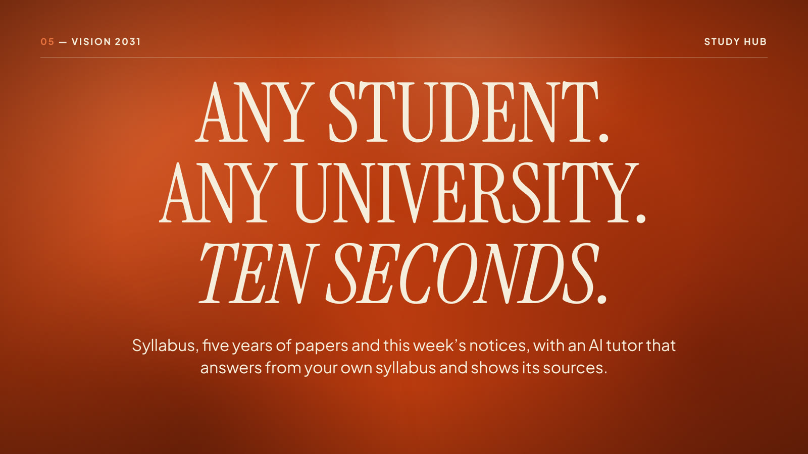
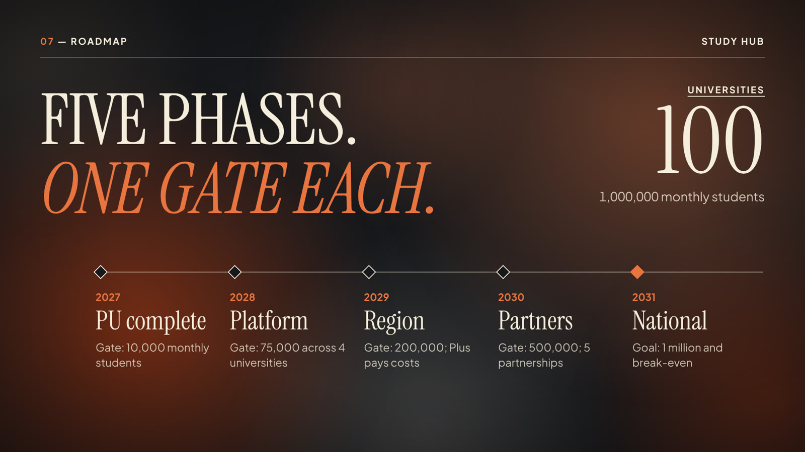

  

<h1 align="center">Study Hub</h1>

  <b>Every university’s papers, syllabus and notices. One free app.</b> 
  The five-year vision for growing <a href="https://pu-study-hub-orcin.vercel.app/">PU Study Hub</a> from one university to a hundred.

  <a href="media/study-hub-pitch.mp4">▶ Watch the full 65-second pitch (with sound)</a> ·
  <a href="https://pu-study-hub-orcin.vercel.app/">Try the live app</a> ·
  <a href="docs/FOUNDING-PLAN.md">Read the full plan</a>

---

## The problem

Exam week starts with a hunt. Previous year papers (PYQs), syllabus PDFs and datesheets are scattered across university portals, notice boards, WhatsApp groups and photocopy shops. Copies conflict, years go missing, datesheets change at short notice, and general chatbots don’t know your university’s syllabus.

India had about **4.5 crore students** in higher education in 2023-24 ([AISHE, via Careers360](https://news.careers360.com/aishe-2023-24-higher-education-enrolment-reaches-4-50-crore-female-enrolment-rises-42-percentage-since-2014-15/amp)). Panjab University alone has about 200 affiliated colleges ([PU profile](https://pu.ac.in/pu-profile.php)).

## What exists today

PU Study Hub is live for Panjab University students:

- A course and semester picker covering the full PU course list
- Course and subject pages with papers and syllabus
- Notices and datesheets, filtered by course, with a NEW badge
- **Ask AI**, which answers from the library with sources and labels any web fallback
- Installable, open source, built by one student

The product works. The next job is real content in place of sample data before the May 2027 exams.

## The vision for 2031

Any college student in India opens one app, picks their university, course and semester, and within ten seconds has their syllabus, five years of papers and this week’s notices. An AI tutor answers only from their own syllabus and shows where each answer came from.

**Principles we won’t trade away**

1. **Free core, forever.** PYQs, syllabus and notices never go behind a paywall.
2. **Show the source.** Every document links to its origin; every AI answer cites its page.
3. **Students first.** No tracking ads. Student data is never sold.
4. **Phone first.** Works on a budget Android phone on weak 4G.
5. **Work with universities.** Ask permission, credit sources, remove within 48 hours on request.
6. **Open by default.** The code stays open source.

## Roadmap

| Phase | When | What ships | Gate to move on |
| --- | --- | --- | --- |
| 1 · PU complete | Jan to Jun 2027 | Real papers for PU’s top 20 programmes, weekly notice sync, 10 campus ambassadors, a new brand name | 10,000 monthly students in the May 2027 exams; takedown process live |
| 2 · Platform | Jul 2027 to Dec 2028 | Multi-campus rebuild, student uploads with moderator review, 3 more universities in Punjab and Chandigarh | 75,000 monthly students across 4 universities |
| 3 · Region | 2029 | 10 universities in North India, Hindi and Punjabi interface, Android app, Study Hub Plus | 200,000 monthly students; Plus covers hosting and AI costs |
| 4 · Partners | 2030 | 30 universities, official university partnerships, college dashboard | 500,000 monthly students; 5 official partnerships |
| 5 · National | 2031 | 100 universities, self-serve onboarding, AI tutor per syllabus, public API | **1,000,000 monthly students and break-even** |

If a gate is missed, we stay in that phase and fix the cause before adding universities.

## How content flows

Sources → Collect → Process (OCR, tagging, duplicate checks) → **Human review** → Publish → Students

Nothing skips review. A student’s error report sends the document back to review. One codebase and one database serve every campus; each record carries a campus id, so adding a university means adding data, not a new app.

## Business model

| Stream | What | Price (to test) | From |
| --- | --- | --- | --- |
| Study Hub Plus | Unlimited AI, offline exam packs, exam planner | ₹49 a month or ₹299 a year | 2029 |
| Campus partnerships | Verified notice channel, campus page, usage reports | ₹25,000 to ₹1,00,000 per institution a year | 2030 |
| Sponsored listings | Labelled scholarships and internships, matched by course, never by tracking | Flat fee | 2029 |
| Grants and donations | Support for a free public resource | Varies | Now |

2031 model: 3% of 1 million students on Plus (≈ ₹90 lakh) plus 100 partners (≈ ₹50 lakh) gives ≈ ₹1.4 crore a year, about equal to planned costs.

## What Phase 1 needs

- **₹3 to 5 lakh** for hosting, AI, a legal opinion and company setup in 2027
- **10 campus ambassadors** in PU’s largest colleges
- **2 advisors**: a PU faculty member and a copyright lawyer
- **1 PU department** willing to link its official papers

Want to help with any of these? Open an issue or start a discussion.

---

Music in the pitch video: “Covert Affair” by Kevin MacLeod (<a href="https://incompetech.com">incompetech.com</a>), licensed under <a href="http://creativecommons.org/licenses/by/4.0/">Creative Commons: By Attribution 4.0</a>.

Study Hub is an independent, student-built project and is not affiliated with Panjab University or any other university. Figures marked as targets or models are plans, not forecasts. Market figures come from secondary reports; verify against official sources before reuse.
